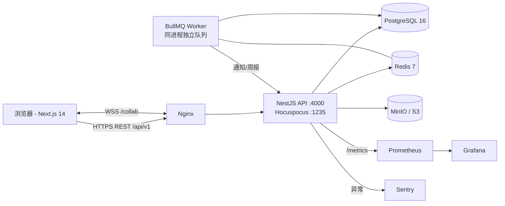
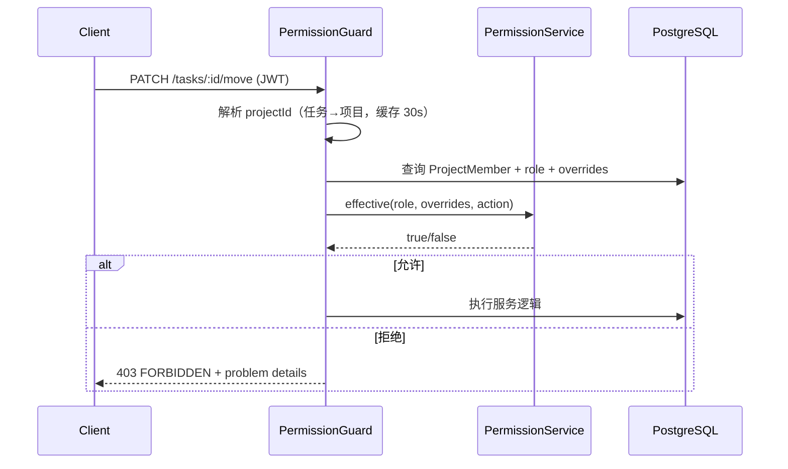
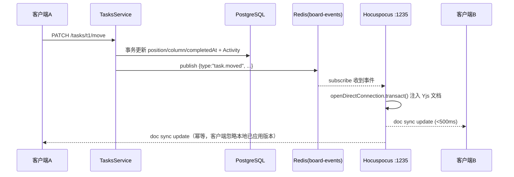
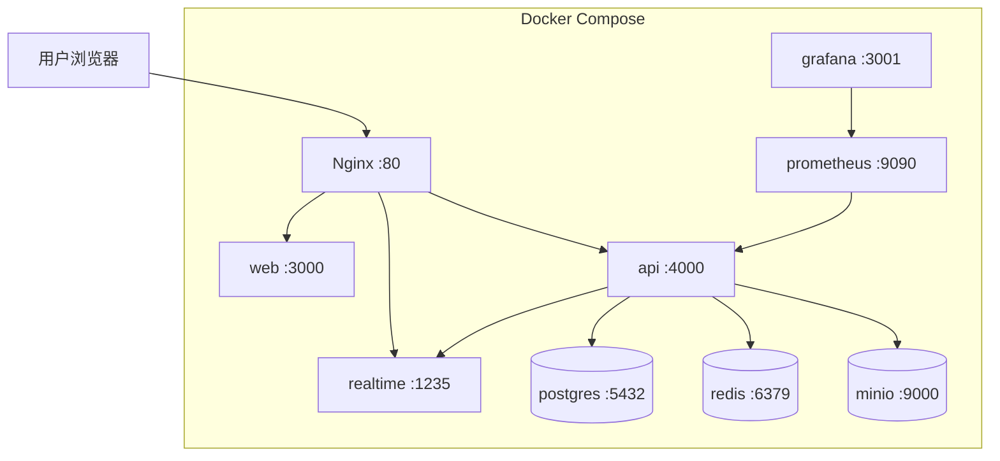

# TeamFlow 架构设计（v1.0）

> 模块化单体 + 独立前端；实时层嵌入 API 进程。目标是「一个仓库、一条 compose 命令」即可本地跑通全部 MVP 能力。

## 1. 系统上下文



- **前端**：Next.js App Router，纯展示 + 交互；业务数据全部走 REST；不启用 Server Actions 写业务。
- **API**：NestJS 模块化单体；同一进程内启动 BullMQ Worker 与独立的 Hocuspocus HTTP/WS 服务（端口 1235，不与 Nest HTTP 共享 upgrade，支持横向拆分）。
- **事实源**：PostgreSQL；Redis 仅用于队列与实时事件总线；Yjs 文档为看板位置的派生状态。

## 2. 仓库结构

```
teamflow/
├── apps/
│   ├── api/                  # NestJS 10
│   │   ├── prisma/           # schema + migrations + seed
│   │   └── src/
│   │       ├── common/       # 守卫/拦截器/过滤器/工具
│   │       ├── config/       # 环境变量校验（zod）
│   │       ├── modules/      # 按领域划分
│   │       │   ├── auth/
│   │       │   ├── users/
│   │       │   ├── projects/
│   │       │   ├── members/  # 邀请、角色、权限覆盖
│   │       │   ├── permissions/
│   │       │   ├── tasks/
│   │       │   ├── comments/
│   │       │   ├── attachments/
│   │       │   ├── notifications/
│   │       │   ├── activities/
│   │       │   ├── reports/
│   │       │   ├── realtime/ # Hocuspocus 服务(1235) + Redis bridge
│   │       │   ├── services/ # 领域服务、守卫、纯函数
│   │       │   ├── queues/   # BullMQ 注册与处理器
│   │       │   └── health/
│   │       └── main.ts
│   └── web/                  # Next.js 14
│       └── src/
│           ├── app/          # 路由（App Router）
│           ├── components/   # 通用 + shadcn 组件
│           ├── features/     # 领域组件（board/task/members...）
│           ├── lib/          # api client、i18n 文案常量
│           └── hooks/
├── packages/
│   └── shared/               # zod schema、权限目录、常量、API 类型
├── docs/
├── infra/
│   ├── docker-compose.yml
│   ├── nginx/
│   ├── prometheus/
│   └── grafana/
└── .github/workflows/
```

依赖方向：`shared ← api`、`shared ← web`；shared 不得依赖任何应用；应用之间禁止互相 import。

## 3. 后端模块与职责

| 模块          | 职责                                          | 关键实现                                                                      |
| ------------- | --------------------------------------------- | ----------------------------------------------------------------------------- |
| Auth          | 注册/登录/刷新/登出；JWT 签发                 | scrypt 密码哈希；Refresh Token 哈希存储 + 轮换；Cookie `tf_refresh`           |
| Users         | 当前用户资料、我的任务                        | `PATCH /users/me`；跨项目任务聚合查询                                         |
| Projects      | 项目 CRUD、归档、看板聚合查询                 | 创建事务含默认列；归档拦截写操作                                              |
| Members       | 邀请、接受、角色、权限覆盖                    | 邀请 token 哈希；OWNER 不变量；覆盖键校验                                     |
| Permissions   | 权限目录、有效权限计算、守卫                  | `@RequirePermission()` + `PermissionGuard`；项目上下文解析                    |
| Tasks         | 任务 CRUD、移动（分数索引）                   | `positionBetween(prev, next)`；完成态联动；Redis 事件发布                     |
| Assignments   | 任务负责人推荐（规则评分 + 可选 AI 排序）     | 只读任务/成员/负载；纯函数评分；不写库；限流 10 次/分钟                       |
| Comments      | 评论 CRUD、@解析                              | TipTap JSON → 文本/mentions；软删除                                           |
| Attachments   | 上传/下载/删除                                | `FileInterceptor` 流式写 MinIO；魔数校验；签名 URL                            |
| Notifications | 列表/未读/已读、创建（队列消费）              | dedupeKey 唯一索引；批量已读                                                  |
| Activities    | 时间线查询、事件写入                          | 游标分页 `(createdAt,id)`                                                     |
| Reports       | 周报生成与查询；周期报告实时汇总              | upsert `(projectId, weekStart)`；周期报告复用同一采集器，按需计算不落库       |
| Realtime      | Hocuspocus 独立端口(1235)、Yjs 投影、presence | onAuthenticate 校验 JWT+成员；readOnly 客户端；文档从 DB 重建；Redis 订阅注入 |
| Queues        | `notifications`、`automation`、`reports`      | 幂等 jobId；重试退避；优雅关闭                                                |

### 3.1 请求处理管线

```
Nginx → Nest Controller → JwtAuthGuard → PermissionGuard（需要时）
→ ZodValidationPipe（Query/DTO） → Service（Prisma 事务）
→ DomainEventEmitter（进程内） → Activity 写入
→ 队列（通知） / Redis（看板广播） → RFC 9457 Problem Details 过滤器 → 响应
```

- Controller 不写业务逻辑；Service 不依赖 HTTP 上下文（项目上下文用参数传递）。
- 所有错误经 `ProblemDetailsFilter` 输出统一结构，禁止把 Prisma 原始错误暴露给客户端。

## 4. 权限架构



- 目录与角色预设定义在 `packages/shared/src/permissions.ts`，前后端共用。
- 守卫支持从路由参数 `projectId`、`taskId`、`commentId`、`attachmentId`、`columnId` 解析所属项目。
- 归档项目：`ProjectActiveGuard` 对所有写路由返回 `409 PROJECT_ARCHIVED`。
- 成员变更后发布 `project.member.changed` Redis 事件；实时层收到后复核在线连接的成员关系并断开失效连接。

## 5. 实时看板架构（核心决策）

### 5.1 模型

- 每个项目一份 Yjs 文档 `project:{projectId}`，结构：
  - `Y.Map<taskId, { columnId: string, position: string, updatedAt: number }>`（看板投影）
  - `Y.Map<columnId, { position: string }>`（列顺序投影）
  - `Y.Map meta`：`schemaVersion` 与 `lastEvent`（`{ type, taskId?, columnId?, at }`，用于元数据变更提示）
- **服务端权威**：所有客户端连接均为 `readOnly: true`，只能发送 awareness；文档写入只由服务端通过 `openDirectConnection().transact()` 执行。
- **文档即投影**：不在 Yjs/快照中持久化业务数据；每个文档在首次连接时从 `board_columns` + `tasks` 重建，数据库是唯一事实源。
- Presence 通过 Awareness 同步：`{ userId, draggingTaskId?, selectedTaskId?, updatedAt }`；昵称/头像/颜色由客户端用已加载成员列表按 `userId` 解析（防伪造）。
- 数据库是事实源：REST 提交成功后发布 Redis 事件；实时层注入 Yjs 文档，Hocuspocus 广播给所有连接。事件永不回写数据库。



### 5.2 为什么不是客户端 CRDT 写入

| 方案                                   | 优点                               | 缺点                                                                           |
| -------------------------------------- | ---------------------------------- | ------------------------------------------------------------------------------ |
| 客户端直接写 Yjs 文档（纯 CRDT）       | 离线/并发编辑能力强                | 与 Postgres 权威数据双写难一致；服务端逐条校验成本高；权限撤回后需清理历史更新 |
| **服务端权威 Yjs + REST 写入（选用）** | 单一事实源、权限天然受控、审计简单 | 依赖服务端事件顺序；离线能力弱；并发冲突为最后写入生效                         |

MVP 目标是小型团队在线协作，不要求离线编辑；选用服务端权威模型，Awareness 提供「正在拖动/光标/在线头像」的协作感。

### 5.3 并发与顺序

- 任务移动以 API 到达顺序为准（PostgreSQL 事务串行化该行）；新位置在事务内基于当前列状态计算。
- 两个用户同时移动同一任务：后提交者覆盖，广播顺序由 Redis 频道保证（单实例）；前端以收到的最后事件为准。
- 分数索引生成：`positionBetween(prev, next)`（base62，最多 64 字符）；列尾追加时在末尾字符区间取中值，必要时追加后缀，避免整列重写。
- Yjs 更新不要求版本号：文档状态收敛；`serverSeq` 仅用于客户端调试日志。

### 5.4 连接与恢复

- 客户端加载看板：先 `GET /projects/{id}/board` 渲染，再建立 WS 补齐增量；WS 断线期间使用 TanStack Query 轮询（10s）兜底，重连后重新拉取基线。
- 服务端文档加载：`onLoadDocument` 直接由 `board_columns` + `tasks` 查询构建 Y.Doc（不读快照、不持久化 Yjs 二进制）；文档在最后一个连接断开后卸载，下次连接再重建。
- Nginx：`/collab` → `api:1235`，升级头 + 120s read timeout；客户端 30s 心跳（Hocuspocus 默认 ping/pong）。
- 升级 Hocuspocus 必须整组锁定版本（server/provider/yjs/y-protocols），见 DEV_CONSTRAINTS §1。

## 6. 自动化与队列

| 队列         | 生产者                                      | 消费者                       | 策略                                                          |
| ------------ | ------------------------------------------- | ---------------------------- | ------------------------------------------------------------- |
| 站内通知     | 业务服务                                    | NotificationsService（同步） | 主流程直接写库 + `UNIQUE(user_id, dedupe_key)` 去重；≤5s 可见 |
| `automation` | Job Scheduler（每 15 分钟）                 | OverdueScanner               | 扫描逾期/24h 内到期任务；单次一条通知（24h 去重）             |
| `reports`    | Job Scheduler（每周一 08:00 Asia/Shanghai） | WeeklyReportGenerator        | 逐项目 upsert；手动生成同步执行，同周幂等                     |

- 看板事件走 Redis 发布/订阅；实时层只注入 Yjs，不回写数据库。
- Redis 不可用：业务写入与通知入库不受影响；看板实时事件丢失（前端轮询兜底），定时任务暂停；`/health` 标记 degraded。
- 进程优雅关闭：停止接收新 job，等待当前 job（≤10s）后退出。
- Worker 与 API 同进程但独立 BullMQ Worker 实例；部署时可拆分为单独服务（环境变量 `WORKER_ONLY=true`）。
- `ENABLE_JOBS` / `ENABLE_REALTIME` 可在测试或降级环境关闭对应组件。

## 7. 附件存储

- 上传：`POST /tasks/{id}/attachments`（multipart）→ API 校验权限/大小/MIME/魔数 → 写入当前存储驱动 → 写 `attachments` 行。
- 存储驱动（`STORAGE_DRIVER`）：
  - `local`（开发默认）：写入 `STORAGE_LOCAL_DIR`；下载 302 到 API 的 HMAC 签名临时链接（5 分钟）。
  - `s3`（部署）：S3 SDK 写入 MinIO/S3（bucket `teamflow`，启动时自动建桶），下载 302 到 5 分钟签名 URL（主机名重写为 `S3_PUBLIC_ENDPOINT`）。
- 删除：删除数据库行 + 删除对象；删除项目时先收集 `objectKey` 再级联删除。
- 本地 MinIO 控制台 `http://localhost:9001`（`docker compose --profile s3 up -d` 启动）。

## 8. 前端架构

- App Router：`app/(auth)/login`、`app/(app)/...`；登录态用 `AuthProvider`（内存 access token + 启动时静默刷新）。
- 数据层：TanStack Query v5；`queryKey` 规范：`['board', projectId]`、`['task', taskId]`、`['notifications', filters]`；写操作成功后精确失效相关 key。
- 实时层：`useBoardSync(projectId)` 封装 Hocuspocus provider；文档更新时局部更新 board 缓存；awareness 状态用独立 store，避免整页重渲染。
- 权限 UI：登录后拉取 `permissions/me` 与成员列表；按钮级裁剪，但以服务端 403 兜底。
- 组件：shadcn/ui 基础组件 + Tailwind；拖拽 `@dnd-kit/core + sortable`；富文本 TipTap（评论与描述共用 `RichTextEditor`）。
- 错误处理：统一 `ApiError`（problem+json）→ toast；401 自动刷新一次，失败跳转登录。

## 9. 可观测性

- `GET /health`：进程存活 + DB/Redis/实时服务启动状态（degraded 时 200 + status）。
- `GET /metrics`：HTTP 直方图、WS 连接数、BullMQ job 计数、看板广播延迟。
- Sentry：API 在 `SENTRY_DSN` 存在时启用（`sendDefaultPii=false`，性能采样 10%）；Web 端预留 DSN 环境变量，Next instrumentation 为后续项。
- 日志：pino JSON，含 `requestId`、`userId`（脱敏）；禁止记录密码/token/附件内容。
- Grafana 面板（provisioned）：API QPS/延迟、队列积压、WS 连接数、逾期扫描耗时。

## 10. 安全要点

| 面      | 措施                                                                                                                                     |
| ------- | ---------------------------------------------------------------------------------------------------------------------------------------- |
| 认证    | scrypt（N=2^15, r=8, p=3, maxmem=64MiB）；JWT HS256 15m；Refresh 7d 轮换 + 重放检测，哈希入库；Cookie HttpOnly/SameSite=Lax/Secure(生产) |
| 授权    | 每个项目级路由 `PermissionGuard`；资源归属解析；OWNER 不变量                                                                             |
| 输入    | zod 全量校验；富文本 JSON 大小限制；标签/文件名长度限制；Prisma 参数化                                                                   |
| 上传    | 白名单 MIME + 魔数；10MB；随机对象键；签名下载                                                                                           |
| Web     | 输出转义（TipTap 渲染为受控组件，不使用 innerHTML）；CSP（生产 Nginx 配置）                                                              |
| 限流    | 登录 10 次/15 分钟/IP；注册 5 次/小时/IP；全局 300 次/分钟/用户                                                                          |
| AI 出站 | 仅 http/https；调用前校验主机并拒绝 loopback/私有/保留地址；开发环境需显式 `AI_ALLOW_LOOPBACK=true` 才允许 loopback；禁止重定向          |
| 其他    | Helmet；CORS 白名单；请求体 1MB 限制（附件路由除外）                                                                                     |

## 11. 部署拓扑



- 生产建议：API 多副本时启用 Hocuspocus Redis 扩展；或按项目哈希做 sticky（Nginx `ip_hash`），MVP 单副本。
- 数据库备份：`pg_dump` 每日 + 保留 14 天（部署手册）。
- 迁移：容器启动前执行 `prisma migrate deploy`（init job 或 entrypoint）。

## 12. 架构决策记录（ADR）

| ADR     | 决策                                     | 理由                                                        | 后果                                                   |
| ------- | ---------------------------------------- | ----------------------------------------------------------- | ------------------------------------------------------ |
| ADR-001 | pnpm monorepo（apps + packages/shared）  | 共享 zod 契约与权限目录，单一版本管理                       | 需要约束依赖方向                                       |
| ADR-002 | REST 契约优先（OpenAPI 3.1）             | 前后端解耦、可测试、可生成文档                              | 需维护契约与 zod 同步                                  |
| ADR-003 | 服务端权威 Yjs（readOnly 客户端）        | DB 为事实源，权限/审计简单                                  | 无离线编辑；依赖服务端广播                             |
| ADR-004 | 分数索引排序                             | 插入 O(1) 更新、避免整列重排                                | 需实现并测试位置算法                                   |
| ADR-005 | BullMQ 异步通知/报表                     | 削峰、可重试、可观测                                        | Redis 成为关键依赖                                     |
| ADR-006 | scrypt + Refresh 轮换                    | 无第三方原生依赖、跨平台、安全                              | 需自行封装哈希格式                                     |
| ADR-007 | 附件经 API 代理上传                      | 统一鉴权/魔数校验、避免 MinIO CORS                          | API 带宽增加；大文件后续改直传                         |
| ADR-008 | Hocuspocus 独立端口(1235)托管于 API 进程 | 避免与 Nest HTTP 抢 upgrade；MVP 部署简单、共享 Prisma/认证 | 横向扩展需拆分进程并启用 Redis 扩展；API 重启会断开 WS |
| ADR-009 | 周报固定 Asia/Shanghai                   | 目标用户在国内高校                                          | 多时区需后续支持                                       |
| ADR-010 | 前端不使用 Server Actions 写业务         | 已有 NestJS API，避免双写入口                               | 需处理 CORS 与 token 刷新                              |

## 13. 故障与降级

| 故障            | 表现            | 降级                                                         |
| --------------- | --------------- | ------------------------------------------------------------ |
| Redis 宕机      | 队列/广播不可用 | `/health` degraded；写操作返回 503（通知依赖）；看板轮询兜底 |
| Hocuspocus 崩溃 | WS 断开         | 前端指数退避重连 + 10s 轮询；不影响 REST                     |
| MinIO 不可用    | 附件失败        | 返回 `503 STORAGE_UNAVAILABLE`；其余功能正常                 |
| 数据库慢查询    | 看板加载慢      | 索引覆盖；看板单项目 ≤1000 任务上限                          |
| 实时事件丢失    | 看板短暂不一致  | 重连/轮询后以 REST 基线为准                                  |

## 14. v1.1 扩展

| 模块             | 说明                                                                                  |
| ---------------- | ------------------------------------------------------------------------------------- |
| Search           | 在用户参与项目范围内搜索项目/任务/成员；内存 SQL `contains`，规模上限 10 条/组        |
| Subtasks         | `task_subtasks` 表；任务卡片/详情返回进度；TASK_UPDATED 活动；≤50 条                  |
| TaskWatchers     | 创建者/负责人/评论者自动关注；关注者接收 `TASK_UPDATED`/评论通知；分钟级去重          |
| Comments v2      | 单层回复（parent_id）、表情回应（comment_reactions）、回复/表情通知                   |
| Notifications v2 | 通知偏好表预过滤；SSE 内存推送（单实例）；客户端 fetch 流 + 重连                      |
| AI               | `AiService` 调 OpenAI 兼容服务生成子任务建议；未配置/失败透明回退本地规则；不自动写库 |
| Templates        | 创建项目事务内按模板生成列与任务；模板常量在 shared，不落库                           |
| Overview         | 前端基于 `/board` + `/activities` 计算 KPI/工作负载，无新增聚合端点                   |

> SSE 为单实例内存总线；API 多副本部署时需改为 Redis Pub/Sub。AI Key 仅服务端环境变量，前端只读取状态与模型名。

## 15. v1.5–v1.7 模块调整

| 模块        | 调整                                                                                      |
| ----------- | ----------------------------------------------------------------------------------------- |
| Assignments | 新增 `assignments` 模块：纯函数评分 + 可选 AI 排序，返回候选人建议；不写任务、不写库      |
| Reports     | 新增 `GET /reports/period` 与叙述端点；复用既有 `collectPeriod` 采集器，按需实时计算      |
| Members     | `project_members.skills` 职能标签；成员自编辑与负责人编辑，变更写 `MEMBER_SKILLS_CHANGED` |
| AI          | 周期叙述、负责人排序增强、`ai-plan` 拆解与分工建议；统一本地规则回退，不自动写业务数据    |
| 基础设施    | 无新增队列/报告表；仅 v1.6 迁移增加 `skills` 列与活动枚举值                               |

- 周期报告与 AI 计划均不新增后台任务；`reports`/`automation` 队列行为不变。
- 报告、推荐与 AI 计划端点均为只读计算；职能标签写入沿用既有成员写接口。
