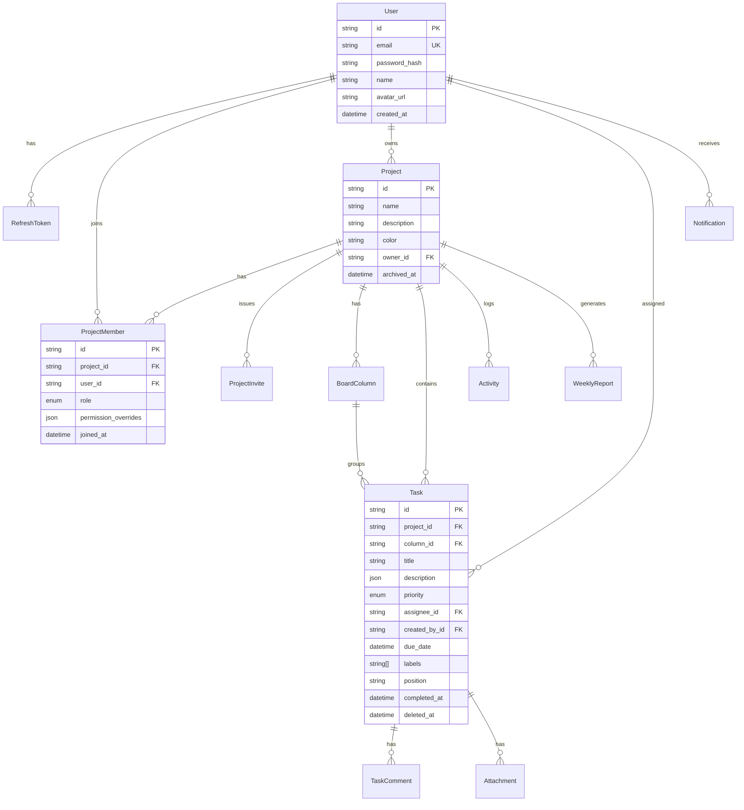

# TeamFlow 数据模型（v1.0）

> 事实源：PostgreSQL 16，使用 Prisma 6 管理。本文与 `docs/openapi.yaml`、`apps/api/prisma/schema.prisma` 必须保持一致；任何变更遵循「先改契约与本文 → 再迁移 → 再改代码」。
>
> 通用约定：所有表使用 snake_case（`@map/@@map`）；主键为 Prisma `cuid()`；时间统一 `timestamptz`，API 传输 ISO 8601 UTC；金额类字段不存在；除特别说明外不做物理外键失效处理（`onDelete` 显式声明）。

## 1. ER 图



## 2. 枚举

```prisma
enum ProjectRole {
  OWNER
  ADMIN
  MEMBER
  VIEWER
}

enum TaskPriority {
  LOW
  MEDIUM
  HIGH
  URGENT
}

enum NotificationType {
  TASK_ASSIGNED
  TASK_COMMENTED
  MENTION
  TASK_DUE_SOON
  TASK_OVERDUE
  MEMBER_JOINED
  MEMBER_REMOVED
  ROLE_CHANGED
  WEEKLY_REPORT
  INVITE
}

enum ActivityType {
  PROJECT_CREATED
  PROJECT_UPDATED
  PROJECT_ARCHIVED
  PROJECT_UNARCHIVED
  MEMBER_JOINED
  MEMBER_REMOVED
  MEMBER_ROLE_CHANGED
  MEMBER_PERMISSIONS_CHANGED
  COLUMN_CREATED
  COLUMN_UPDATED
  COLUMN_DELETED
  TASK_CREATED
  TASK_UPDATED
  TASK_MOVED
  TASK_COMPLETED
  TASK_REOPENED
  TASK_ASSIGNED
  TASK_DELETED
  COMMENT_CREATED
  COMMENT_UPDATED
  COMMENT_DELETED
  ATTACHMENT_ADDED
  ATTACHMENT_DELETED
  REPORT_GENERATED
}
```

## 3. 表字典

### 3.1 users

| 字段          | 类型        | 约束             | 说明                                  |
| ------------- | ----------- | ---------------- | ------------------------------------- |
| id            | text (cuid) | PK               |                                       |
| email         | text        | UNIQUE, NOT NULL | 存储小写，长度 ≤254                   |
| password_hash | text        | NOT NULL         | `scrypt$N$r$p$salt$hash`（base64url） |
| name          | text        | NOT NULL         | 1–40 字符                             |
| avatar_url    | text        | NULL             | http(s) 外链，≤500 字符               |
| created_at    | timestamptz | NOT NULL         |                                       |
| updated_at    | timestamptz | NOT NULL         |                                       |

索引：`users_email_key (email)`。

### 3.2 refresh_tokens

| 字段       | 类型        | 约束                          | 说明                   |
| ---------- | ----------- | ----------------------------- | ---------------------- |
| id         | text        | PK                            |                        |
| user_id    | text        | FK → users, ON DELETE CASCADE |                        |
| token_hash | text        | UNIQUE, NOT NULL              | SHA-256(raw token) hex |
| expires_at | timestamptz | NOT NULL                      | now + 7d               |
| revoked_at | timestamptz | NULL                          | 轮换/登出时写入        |
| created_at | timestamptz | NOT NULL                      |                        |

索引：`refresh_tokens_user_id_idx (user_id)`。

### 3.3 projects

| 字段                    | 类型        | 约束                           | 说明                |
| ----------------------- | ----------- | ------------------------------ | ------------------- |
| id                      | text        | PK                             |                     |
| name                    | text        | NOT NULL                       | 1–60                |
| description             | text        | NULL                           | ≤500                |
| color                   | text        | NOT NULL, DEFAULT `#6366F1`    | `^#[0-9A-Fa-f]{6}$` |
| owner_id                | text        | FK → users, ON DELETE RESTRICT | 创建者              |
| archived_at             | timestamptz | NULL                           | 非空即归档（只读）  |
| created_at / updated_at | timestamptz | NOT NULL                       |                     |

索引：`projects_owner_id_idx (owner_id)`、`projects_archived_at_idx (archived_at)`。

> 删除项目：删除前收集全部附件 `object_key` 入队清理，再硬删除并级联；对象存储文件在 24h 内清理完成。

### 3.4 project_members

| 字段                 | 类型        | 约束                             | 说明                                          |
| -------------------- | ----------- | -------------------------------- | --------------------------------------------- |
| id                   | text        | PK                               |                                               |
| project_id           | text        | FK → projects, ON DELETE CASCADE |                                               |
| user_id              | text        | FK → users, ON DELETE CASCADE    |                                               |
| role                 | ProjectRole | NOT NULL, DEFAULT MEMBER         | OWNER 唯一性由服务层保证                      |
| permission_overrides | jsonb       | NULL                             | `{"action": boolean}`，仅对 17 项目录中键有效 |
| joined_at            | timestamptz | NOT NULL                         |                                               |

约束：`UNIQUE (project_id, user_id)`；索引：`(user_id)`。
业务不变量：每个项目恰好 1 条 `role=OWNER`；OWNER 的 `permission_overrides` 必须为 NULL。

### 3.5 project_invites

| 字段          | 类型        | 约束                             | 说明                                         |
| ------------- | ----------- | -------------------------------- | -------------------------------------------- |
| id            | text        | PK                               |                                              |
| project_id    | text        | FK → projects, ON DELETE CASCADE |                                              |
| email         | text        | NOT NULL                         | 小写                                         |
| role          | ProjectRole | NOT NULL                         | 不可为 OWNER                                 |
| token_hash    | text        | UNIQUE, NOT NULL                 | SHA-256(raw token)；明文仅在创建响应返回一次 |
| invited_by_id | text        | FK → users, ON DELETE CASCADE    |                                              |
| expires_at    | timestamptz | NOT NULL                         | 创建 + 7d                                    |
| accepted_at   | timestamptz | NULL                             |                                              |
| revoked_at    | timestamptz | NULL                             |                                              |
| created_at    | timestamptz | NOT NULL                         |                                              |

索引：`(project_id, email)`；服务层保证同项目同邮箱仅一条有效邀请（未接受、未撤销、未过期），新邀请自动撤销旧的。

### 3.6 board_columns

| 字段                    | 类型        | 约束                             | 说明                 |
| ----------------------- | ----------- | -------------------------------- | -------------------- |
| id                      | text        | PK                               |                      |
| project_id              | text        | FK → projects, ON DELETE CASCADE |                      |
| name                    | text        | NOT NULL                         | 1–30                 |
| position                | text        | NOT NULL                         | 分数索引，字典序升序 |
| is_done                 | boolean     | NOT NULL, DEFAULT false          | 完成列标记           |
| created_at / updated_at | timestamptz | NOT NULL                         |                      |

约束：`UNIQUE (project_id, position)`；索引：`(project_id, position)`。
默认三列：`待办`（false）、`进行中`（false）、`已完成`（true）。

### 3.7 tasks

| 字段                    | 类型         | 约束                                   | 说明                         |
| ----------------------- | ------------ | -------------------------------------- | ---------------------------- |
| id                      | text         | PK                                     |                              |
| project_id              | text         | FK → projects, ON DELETE CASCADE       |                              |
| column_id               | text         | FK → board_columns, ON DELETE RESTRICT | 删除列前必须迁移任务         |
| title                   | text         | NOT NULL                               | 1–200                        |
| description             | jsonb        | NULL                                   | ProseMirror JSON，≤100KB     |
| priority                | TaskPriority | NOT NULL, DEFAULT MEDIUM               |                              |
| assignee_id             | text         | FK → users, ON DELETE SET NULL, NULL   | 必须是项目成员（服务层校验） |
| created_by_id           | text         | FK → users, ON DELETE RESTRICT         |                              |
| due_date                | timestamptz  | NULL                                   |                              |
| labels                  | text[]       | NOT NULL, DEFAULT `{}`                 | ≤5 个，单个 1–20 字符        |
| position                | text         | NOT NULL                               | 分数索引，列内排序           |
| completed_at            | timestamptz  | NULL                                   | `is_done=true` 列时非空      |
| deleted_at              | timestamptz  | NULL                                   | 软删除                       |
| created_at / updated_at | timestamptz  | NOT NULL                               |                              |

索引：

- `tasks_board_idx (project_id, deleted_at, column_id, position)` — 看板加载
- `tasks_assignee_idx (assignee_id, deleted_at, completed_at)` — 我的任务
- `tasks_due_idx (due_date, completed_at, deleted_at)` — 逾期扫描

排序规则：`ORDER BY position ASC, id ASC`（位置冲突时用 id 稳定排序；服务端生成位置时避免冲突）。

### 3.8 task_comments

| 字段                    | 类型        | 约束                           | 说明                                     |
| ----------------------- | ----------- | ------------------------------ | ---------------------------------------- |
| id                      | text        | PK                             |                                          |
| task_id                 | text        | FK → tasks, ON DELETE CASCADE  |                                          |
| author_id               | text        | FK → users, ON DELETE RESTRICT |                                          |
| body                    | jsonb       | NOT NULL                       | ProseMirror JSON                         |
| body_text               | text        | NOT NULL                       | 提取的纯文本，≤5000 字符，用于校验与摘要 |
| mentions                | text[]      | NOT NULL, DEFAULT `{}`         | 被 @ 的 userId（去重、仅项目成员）       |
| deleted_at              | timestamptz | NULL                           | 软删除保留楼层                           |
| created_at / updated_at | timestamptz | NOT NULL                       |                                          |

索引：`(task_id, created_at)`。

### 3.9 attachments

| 字段           | 类型        | 约束                           | 说明                                         |
| -------------- | ----------- | ------------------------------ | -------------------------------------------- |
| id             | text        | PK                             |                                              |
| task_id        | text        | FK → tasks, ON DELETE CASCADE  |                                              |
| uploaded_by_id | text        | FK → users, ON DELETE RESTRICT |                                              |
| file_name      | text        | NOT NULL                       | 原始文件名（仅展示，≤255）                   |
| mime_type      | text        | NOT NULL                       | 校验后的 MIME                                |
| size_bytes     | integer     | NOT NULL                       | 1–10,485,760                                 |
| object_key     | text        | UNIQUE, NOT NULL               | `projects/{projectId}/tasks/{taskId}/{uuid}` |
| created_at     | timestamptz | NOT NULL                       |                                              |

索引：`(task_id)`；单任务 ≤20 个（服务层校验）。

### 3.10 activities

| 字段       | 类型         | 约束                                 | 说明                        |
| ---------- | ------------ | ------------------------------------ | --------------------------- |
| id         | text         | PK                                   |                             |
| project_id | text         | FK → projects, ON DELETE CASCADE     |                             |
| actor_id   | text         | FK → users, ON DELETE SET NULL, NULL | 系统事件为空                |
| task_id    | text         | NULL                                 | 不设 FK（任务删除后仍展示） |
| type       | ActivityType | NOT NULL                             |                             |
| payload    | jsonb        | NOT NULL                             | 渲染快照，键见 §4           |
| created_at | timestamptz  | NOT NULL                             |                             |

索引：`activities_project_idx (project_id, created_at DESC, id DESC)`、`(task_id)`。
保留 180 天（定时清理；MVP 仅脚本，默认开启）。

### 3.11 notifications

| 字段       | 类型             | 约束                          | 说明                 |
| ---------- | ---------------- | ----------------------------- | -------------------- |
| id         | text             | PK                            |                      |
| user_id    | text             | FK → users, ON DELETE CASCADE | 接收人               |
| type       | NotificationType | NOT NULL                      |                      |
| payload    | jsonb            | NOT NULL                      | 含跳转所需 id 与摘要 |
| dedupe_key | text             | NULL                          | 幂等键               |
| read_at    | timestamptz      | NULL                          | 非空即已读           |
| created_at | timestamptz      | NOT NULL                      |                      |

约束：`UNIQUE (user_id, dedupe_key)`（dedupe_key 为 NULL 时允许多条）。
索引：`(user_id, read_at, created_at DESC)`。
保留 90 天。

### 3.12 weekly_reports

| 字段                    | 类型        | 约束                             | 说明                  |
| ----------------------- | ----------- | -------------------------------- | --------------------- |
| id                      | text        | PK                               |                       |
| project_id              | text        | FK → projects, ON DELETE CASCADE |                       |
| week_start              | date        | NOT NULL                         | 周一（Asia/Shanghai） |
| week_end                | date        | NOT NULL                         | 周日                  |
| data                    | jsonb       | NOT NULL                         | 见 §5                 |
| created_by_id           | text        | NULL                             | 自动生成为 NULL       |
| created_at / updated_at | timestamptz | NOT NULL                         |                       |

约束：`UNIQUE (project_id, week_start)` — 重复生成执行 upsert。

> 实时看板不单独建表：Yjs 文档是 `board_columns` + `tasks` 的内存投影，随连接重建，不持久化二进制快照（决策见 ARCHITECTURE ADR-003/008）。

## 4. Activity payload 约定

| type                                     | payload 示例                                                                                                 |
| ---------------------------------------- | ------------------------------------------------------------------------------------------------------------ |
| `TASK_CREATED`                           | `{"taskId":"...","title":"...","columnId":"..."}`                                                            |
| `TASK_UPDATED`                           | `{"taskId":"...","title":"...","changes":{"priority":["LOW","HIGH"]}}`                                       |
| `TASK_MOVED`                             | `{"taskId":"...","title":"...","fromColumnId":"...","toColumnId":"...","fromPosition":"a","toPosition":"m"}` |
| `TASK_COMPLETED` / `TASK_REOPENED`       | `{"taskId":"...","title":"...","columnId":"..."}`                                                            |
| `TASK_ASSIGNED`                          | `{"taskId":"...","title":"...","fromAssigneeId":null,"toAssigneeId":"..."}`                                  |
| `TASK_DELETED`                           | `{"taskId":"...","title":"..."}`                                                                             |
| `COMMENT_CREATED`                        | `{"taskId":"...","commentId":"...","excerpt":"..."}`                                                         |
| `MEMBER_JOINED`                          | `{"userId":"...","name":"...","role":"MEMBER"}`                                                              |
| `MEMBER_ROLE_CHANGED`                    | `{"userId":"...","from":"MEMBER","to":"ADMIN"}`                                                              |
| `MEMBER_PERMISSIONS_CHANGED`             | `{"userId":"...","overrides":{"board:manage":true}}`                                                         |
| `COLUMN_CREATED` / `UPDATED` / `DELETED` | `{"columnId":"...","name":"..."}`                                                                            |
| `PROJECT_CREATED`                        | `{"name":"..."}`                                                                                             |
| `REPORT_GENERATED`                       | `{"reportId":"...","weekStart":"2026-11-16"}`                                                                |

payload 不允许包含密码、访问令牌、完整文件内容。例外：`INVITE` 通知可包含一次性邀请链接 `inviteUrl`（仅发送给被邀请人，7 天有效）。

## 5. WeeklyReport.data 结构

```json
{
  "weekStart": "2026-11-16",
  "weekEnd": "2026-11-22",
  "metrics": {
    "createdTasks": 12,
    "completedTasks": 9,
    "overdueTasks": 2,
    "comments": 34,
    "activeMembers": 5,
    "totalTasks": 27
  },
  "completionByMember": [
    { "userId": "u1", "name": "张三", "completed": 5 },
    { "userId": "u2", "name": "李四", "completed": 4 }
  ],
  "highlightTasks": [
    { "taskId": "t1", "title": "完成登录页", "completedAt": "2026-11-20T10:00:00.000Z" }
  ]
}
```

## 6. 不变量与事务边界

1. 项目创建：`projects` + `project_members(OWNER)` + 3 条 `board_columns` + `PROJECT_CREATED` 活动，必须在同一事务。
2. 任务移动：更新 `column_id/position/completed_at` + 写 `TASK_MOVED`（或 COMPLETED/REOPENED）活动在同一事务；提交后发布 Redis 事件。
3. 评论创建：写评论 + 写活动同事务；通知入队失败不回滚业务（可重试，队列持久化）。
4. 邀请接受：创建成员 + 标记邀请已用 + 写活动同事务；重复接受由 `accepted_at` 条件更新保证幂等。
5. 周报生成：按 `(project_id, week_start)` upsert，同一事务内写活动；通知去重键包含周起始日。
6. 通知去重：依赖 `UNIQUE (user_id, dedupe_key)`，插入冲突时静默跳过。
7. 成员移除：删除 `project_members` 行 + 写活动；该用户历史活动保留。
8. OWNER 保护：任何更新/删除 OWNER 成员关系的操作必须被拒绝（`409 OWNER_IMMUTABLE`）。

## 7. 迁移与种子

- 开发：`pnpm db:migrate`（`prisma migrate dev`）；CI/生产：`prisma migrate deploy`。
- 种子 `prisma/seed.ts`：2 个演示用户（`alice@example.com` / `bob@example.com`，密码 `Passw0rd!`），1 个项目、3 列、6 个任务、示例评论与通知，便于验收演示。种子仅限非生产环境。
- 所有迁移必须可重复部署（无手工修库）。

## 8. 与 API 契约的映射

| API 资源                    | 表                               | 备注                                   |
| --------------------------- | -------------------------------- | -------------------------------------- |
| `/auth/*`、`/users/me`      | users, refresh_tokens            | 不返回 password_hash                   |
| `/projects/*`               | projects, project_members        | 项目详情返回成员摘要                   |
| `/projects/{id}/board`      | projects, board_columns, tasks   | 单次返回列 + 未删除任务                |
| `/tasks/*/comments`         | task_comments                    | 软删记录保留占位                       |
| `/tasks/*/attachments`      | attachments                      | 下载 302 签名 URL                      |
| `/notifications/*`          | notifications                    | 未读数来自 count(read_at IS NULL)      |
| `/projects/{id}/activities` | activities                       | 游标：`(created_at,id)` 倒序           |
| `/projects/{id}/reports`    | weekly_reports                   | 周起始日唯一                           |
| WS `/collab`                | board_columns, tasks（只读重建） | 看板投影 + awareness；不落库、不持久化 |

## 9. v1.1 数据扩展

### 9.1 新增表

| 表                         | 关键字段                                                      | 约束/索引                                                   | 说明                                   |
| -------------------------- | ------------------------------------------------------------- | ----------------------------------------------------------- | -------------------------------------- |
| `task_subtasks`            | id, task_id, title, is_done, position, created_at, updated_at | FK task CASCADE；`(task_id, position)`                      | 任务清单，≤50 条，position 递增        |
| `comment_reactions`        | id, comment_id, user_id, emoji, created_at                    | FK comment/user CASCADE；`UNIQUE(comment_id,user_id,emoji)` | 表情回应白名单：👍 ❤️ 😄 🎉 👀         |
| `task_watchers`            | id, task_id, user_id, created_at                              | FK task/user CASCADE；`UNIQUE(task_id,user_id)`             | 任务关注；创建者/负责人/评论者自动加入 |
| `notification_preferences` | id, user_id, type, enabled, updated_at                        | FK user CASCADE；`UNIQUE(user_id,type)`                     | 缺行=默认开启；写入前过滤通知          |

### 9.2 变更字段

- `task_comments.parent_id`：可空自关联（`ON DELETE CASCADE`），仅存根评论 ID，实现单层回复；索引 `(parent_id)`。
- `NotificationType` 新增：`TASK_UPDATED`、`COMMENT_REPLY`、`COMMENT_REACTION`（共 13 值）。
- TaskCard 派生字段 `subtaskTotal/subtaskDone`；TaskDetail 派生 `subtasks[]`、`watching`、`watcherCount`。
- 项目模板（BLANK/COURSE/CLUB/COMPETITION）不落库，仅在创建项目事务中生成列与初始任务。

### 9.3 通知语义

- `TASK_UPDATED`：任务字段更新通知关注者，去重键 `task-updated:{taskId}:{userId}:{分钟}`。
- `COMMENT_REPLY`：回复通知父评论作者；`COMMENT_REACTION`：表情通知评论作者，去重键含评论/操作者/emoji。
- 所有通知写入前按 `notification_preferences` 过滤；SSE 推送仅针对成功入库的通知。
- 任务活动查询使用既有 `activities.task_id` 索引；子任务变更写 `TASK_UPDATED` 活动（payload 含 subtask 动作）。

### 9.4 迁移

- `20261122100000_init`（基线）
- `20261122111500_v1_1_collab`（v1.1 新增表与枚举值）

## 10. v1.2 数据扩展

### 10.1 新增表

| 表                  | 关键字段                                              | 约束/索引                                                                                 | 说明                                        |
| ------------------- | ----------------------------------------------------- | ----------------------------------------------------------------------------------------- | ------------------------------------------- |
| `task_dependencies` | id, task_id, blocked_by_id, created_by_id, created_at | FK task×2/user CASCADE/RESTRICT；`UNIQUE(task_id, blocked_by_id)`；索引 `(blocked_by_id)` | task_id 需等待 blocked_by_id 完成后才能完成 |

- 依赖仅限同项目任务；写入前做环检测，禁止自依赖。
- 任务软删除时同时清理以该任务为依赖方/被依赖方的依赖行。
- `blockedByCount` 仅统计 `blocked_by.deleted_at IS NULL AND blocked_by.completed_at IS NULL`。
- `blockingCount` 仅统计未删除且未完成的下游任务。

### 10.2 变更字段

- `TaskDetail` 新增 `blockedBy[]`、`blocking[]`；TaskCard 新增两个派生计数。
- `ActivityType` 新增 `TASK_DEPENDENCY_ADDED`、`TASK_DEPENDENCY_REMOVED`。
- 活动 payload 记录 `taskId/title/blockedByTaskId/blockedByTitle`，用于时间线展示。

### 10.3 事务边界

- 添加/移除依赖：写 `task_dependencies` + 活动同事务；提交后发布 `task.updated`。
- 移入完成列：依赖校验在事务前读取；存在未满足依赖时 409，携带 `force=true` 才允许。
- 整列标记完成 / 删除列迁移到完成列：同样校验列内任务的未完成依赖，存在则 409。
- 复制任务：任务副本 + 子任务副本 + 关注者 + `TASK_CREATED` 活动同事务。

### 10.4 迁移

- `20261122145456_v1_2_dependencies`（v1.2 依赖表与枚举值）

## 11. v1.3 周报汇总与邮件

### 11.1 周报 data 结构扩展

`weekly_reports.data` 在原有 metrics/排行/亮点任务基础上新增：

- `generatedAt`：本次汇总生成时间。
- `summary`：根据指标、风险与待推进任务生成的确定性文字摘要。
- `completedTaskList[]`：本周完成，最多 10 条。
- `openTaskList[]`：当前待推进，最多 10 条。
- `riskTaskList[]`：逾期或未完成依赖阻塞，含 `reason`。
- `upcomingTaskList[]`：7 天内即将到期，最多 10 条。
- 任务元素：`{taskId,title,columnName,assigneeName,priority,dueDate,completedAt,blockedByCount,blockedByTitles,reason?}`。
- 当前周实时汇总不落库，由查询实时计算；历史快照仍为不可变记录（重新生成时覆盖同周记录）。

### 11.2 活动与邮件审计

- `ActivityType` 新增 `REPORT_EMAIL_SENT`；payload 仅包含 `projectId/subject/recipientCount/sender`，**不保存邮件正文与完整收件人邮箱**。
- Agent Mail OAuth 凭据由 `agently-cli` 存放在系统凭据库（Windows DPAPI 等），TeamFlow 数据库不保存邮箱密码或 Token。
- 发送日志不清空正文，不记录 AI prompt；失败按 CLI 退出码映射为稳定错误码。

### 11.3 迁移

- `20261123094801_v1_3_report_email`（仅扩展 ActivityType 枚举）

## 12. v1.4 账号资料

- 无新增表/字段。`users.avatar_url` 可保存 http(s) URL 或 256×256 压缩图片 data URL（PNG/JPEG/WebP，≤100000 字符）。
- 修改密码更新 `users.password_hash`，并在同一事务删除该用户全部 `refresh_tokens`。
- 无新迁移；头像压缩在前端完成，服务端只校验格式/长度，不解析图片。
